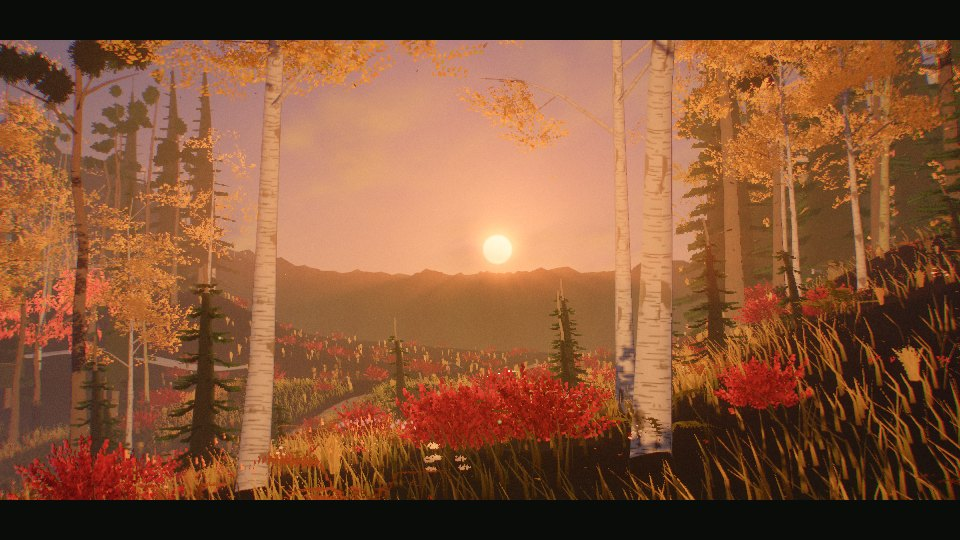
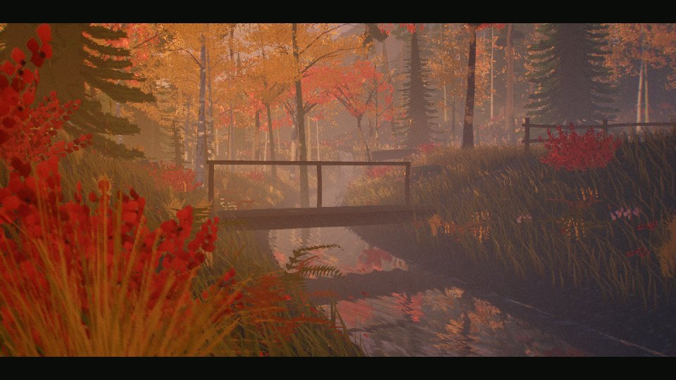
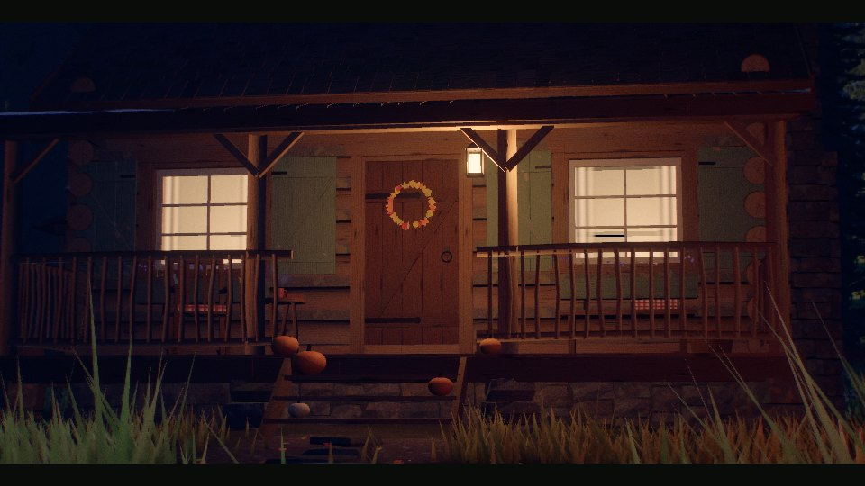

# 林间木屋

初秋森林里的一间木屋，在浏览器里实时渲染。模型、贴图和环境声全部由代码生成，不用任何外部素材。默认是黄昏，可以切换到清晨薄雾或月夜。



| 溪桥 | 月夜门廊 |
|---|---|
|  |  |

## 打开

用浏览器直接打开 `dist/forest-cabin.html`。

- 需要联网：three.js（r170）从 CDN 加载，依次尝试 cdnjs、jsDelivr、unpkg。
- 需要支持 WebGL2 的浏览器，例如新版 Chrome、Edge、Safari、Firefox。

## 操作

- **运镜：** 打开后自动播放 8 个镜头。
- **自由环视：** 在画面上拖动即可接管。
  - 拖动旋转。
  - 滚轮或双指缩放。
  - 右键或双指平移。
  - 30 秒不操作，会回到运镜。
- **控制栏**在底部，包括：
  - 电影 / 漫游切换。
  - 时间滑块，刻度是清晨、黄昏、月夜。
  - 声音（默认关闭）。
  - 画质。
  - 隐藏界面、全屏。
- **快捷键：** `H` 隐藏界面，`F` 全屏，`1` / `2` / `3` 切换清晨、黄昏、月夜。

## 画质

| | 流畅 | 均衡 | 精致 |
|---|---|---|---|
| 像素比上限 | 1.0 | 1.25 | 1.75 |
| 抗锯齿 | FXAA | MSAA 4× | MSAA 4× |
| 阴影贴图 | 1024 | 2048 | 4096 |
| 草叶 | 3 万 | 8 万 | 15 万 |
| 景深采样 | 16 | 32 | 48 |
| 溪水倒影 | 简化 | 简化 | 实时镜面 |

**自动选档**规则如下：

| 情况 | 选档 |
|---|---|
| 软件渲染，或触屏小屏 | 流畅 |
| 其他触屏设备，或集成 / 移动显卡 | 均衡 |
| 其余情况 | 精致 |

渲染分辨率会按帧耗时在 0.6 到 1.0 倍之间自动调整。手动选的画质和声音开关会记在浏览器本地。

## 构建

```sh
node build.mjs
```

构建把 `src/*.js` 按文件名顺序拼成一个内联 module，做完语法检查后输出两个文件：

- `dist/forest-cabin.html`：完整页面，可以直接打开。
- `dist/index.html`：不带文档骨架的同一页面，用于发布为 claude.ai Artifact。

构建需要 Node 18 或更新版本，没有其他依赖。

## 目录

| 文件 | 内容 |
|---|---|
| `template.html` | 页面标题、样式、加载层 / 标题卡 / 控制栏的结构，脚本占位 |
| `build.mjs` | 拼接与语法检查 |
| `src/00-core.js` | three.js 加载与回退、画质分档、随机数、噪声、几何工具 |
| `src/01-shaderlib.js` | 共享 uniform、GLSL 片段（雾、风、天空、植被光照）、材质补丁 |
| `src/02-textures.js` | GPU 烘焙贴图（树皮、木材、石材、地表）、Canvas 植物图集 |
| `src/03-world.js` | 地形、小路与溪流、溪水着色、溪流镜面反射 |
| `src/04-sky.js` | 天空、远山、远景林冠、时间预设、环境光 |
| `src/05-cabin.js` | 木屋：原木墙、屋顶、烟囱、门窗、门廊与摆设 |
| `src/06-yard.js` | 院落：柴垛、菜园、篝火、水井、晾衣绳、木桥 |
| `src/07-trees.js` | 云杉、松、白桦、枫树、幼树、枯木；森林布置与细节层级 |
| `src/08-groundcover.js` | 草、蕨、灌木、野花、岩石、倒木、蘑菇、落叶 |
| `src/09-fx.js` | 炊烟、篝火、热气、光尘、萤火虫、落叶、飞鸟、体积光 |
| `src/10-post.js` | 后期：景深、丁达尔光、泛光、AgX 色调映射与调色、FXAA、遮幅与颗粒 |
| `src/11-camera.js` | 镜头导演、自由环视、转场 |
| `src/12-audio.js` | WebAudio 环境声：风、树叶、溪流、篝火、鸟、蟋蟀、猫头鹰 |
| `src/12-ui.js` | 加载层、标题卡、控制栏、错误提示 |
| `src/13-main.js` | 组装、分阶段生成、主循环、动态分辨率、`window.__cabin` 调试接口 |
